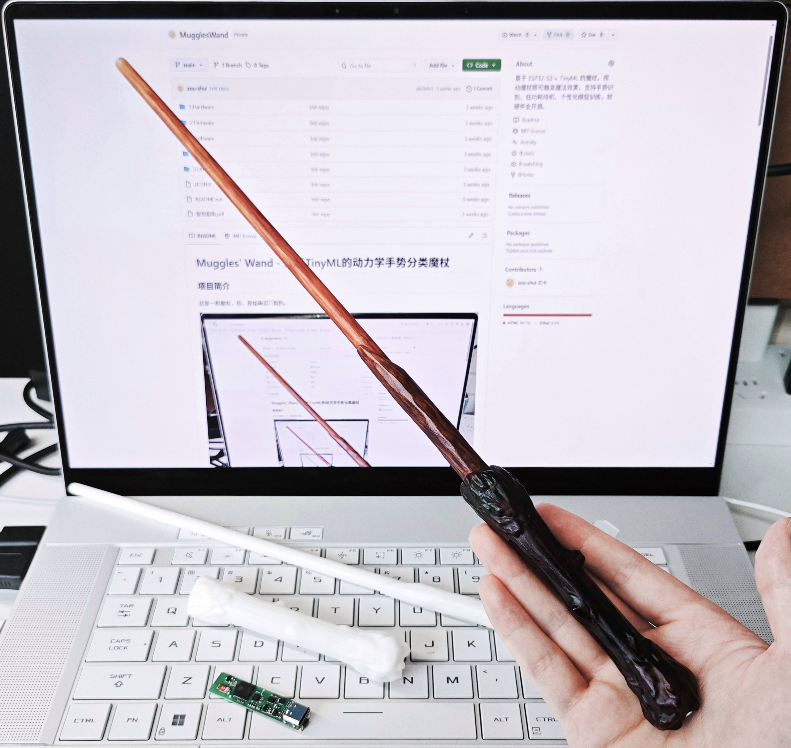
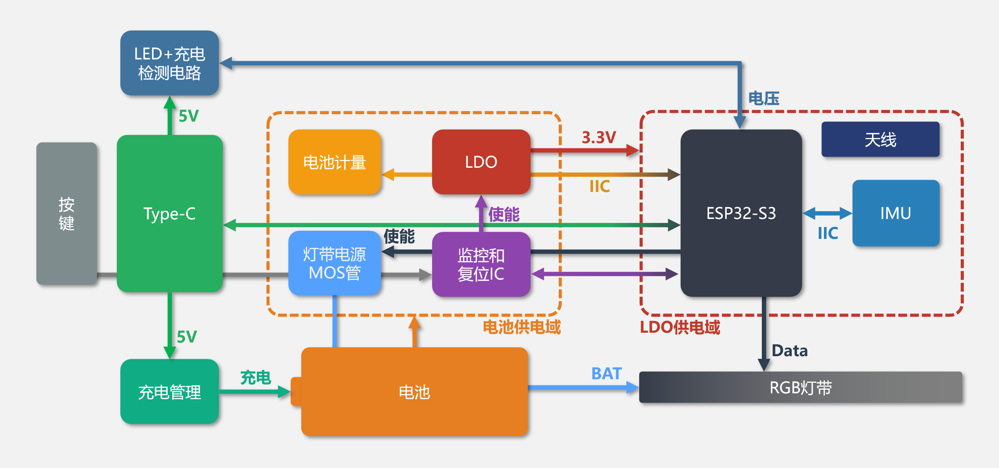
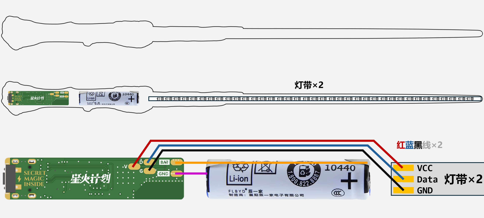
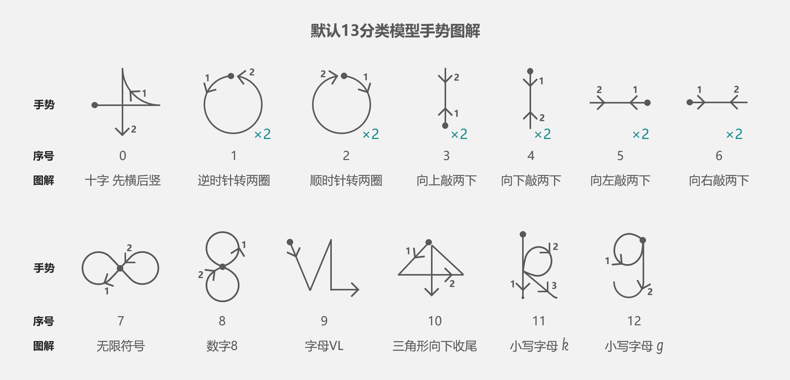
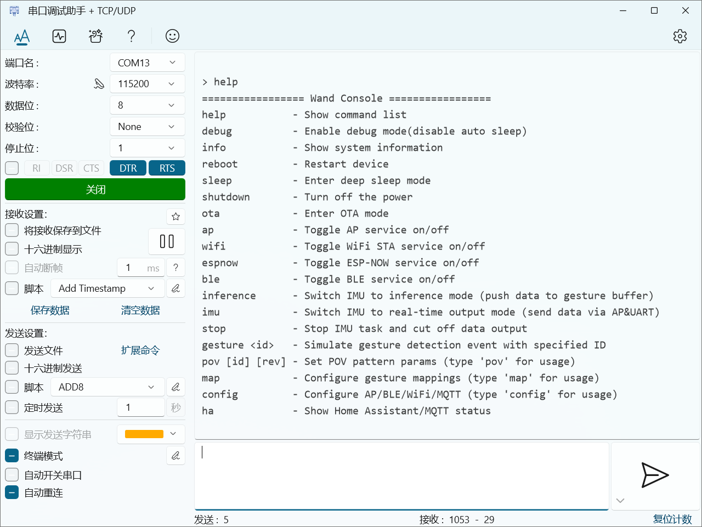
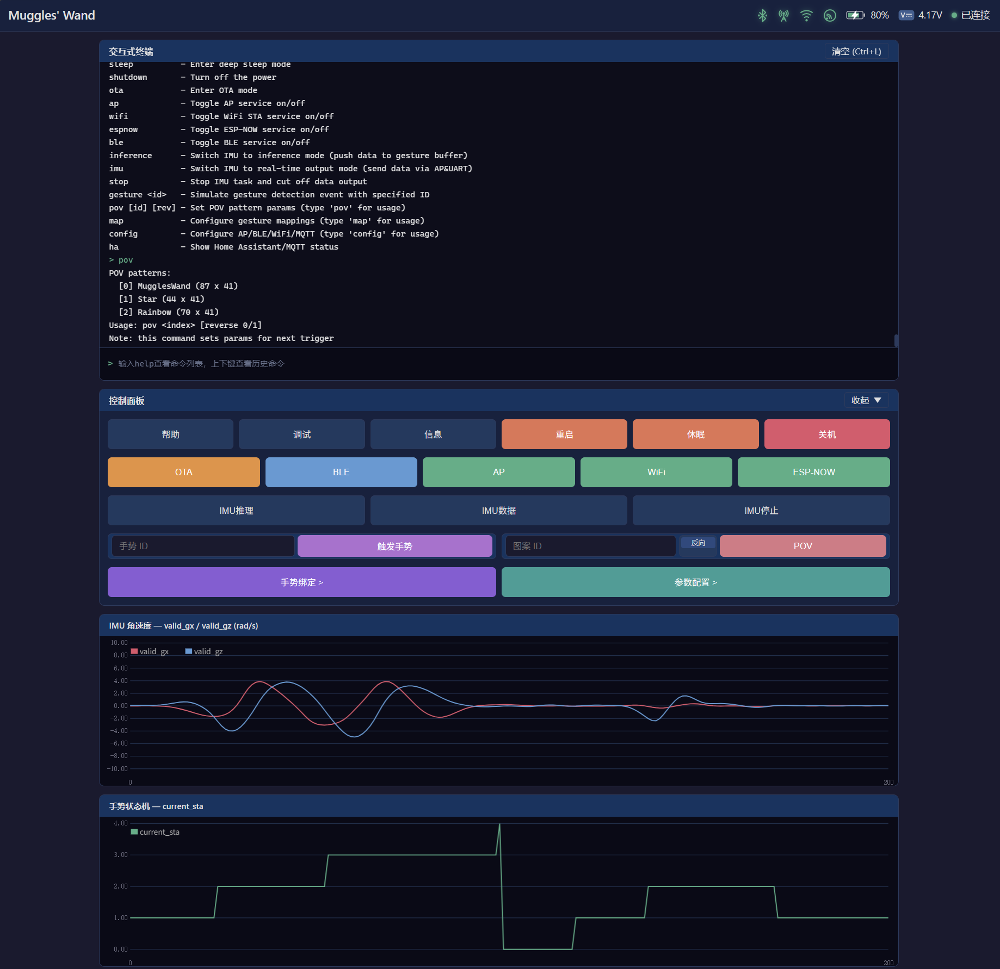
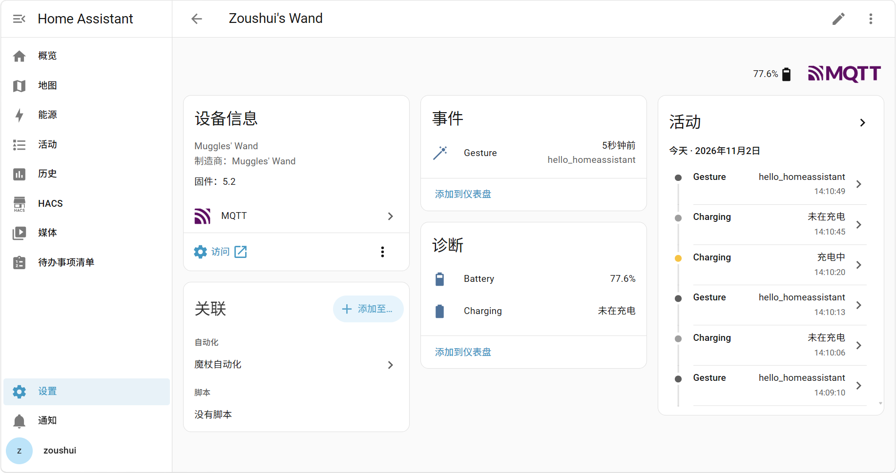

# Muggles' Wand - 基于TinyML的动力学手势分类魔杖

立创开源平台链接：[Muggles' Wand - 给麻瓜设计的魔杖 - 立创开源硬件平台](https://oshwhub.com/zoushui/project_zfbqlpxs)

## 项目简介

这是一根魔杖，但，是给麻瓜[^1]用的。



在哈利波特初代魔杖外壳中嵌入ESP32-S3、六轴 IMU 和神经网络模型，麻瓜无需魔法，只需标准地挥动魔杖，即可触发专属的“魔法效果”（如Lumos[^2]、模拟键鼠、光绘、Home Assistant 自动化等）。

## 视频链接

[【开源】给麻瓜的魔杖](https://www.bilibili.com/video/BV14XaJ6nEzr/?share_source=copy_web&vd_source=b9a966f3c62fa9746bb00910b5fc0d9c)

## 项目特点

- 哈利波特初代魔杖外形，内置RGB灯带提供施法光效。
- 基于ESP32-S3 + ICM42670P六轴 IMU，支持 Wi-Fi、BLE，便于扩展无线控制和交互功能。
- 支持接入 Home Assistant，魔杖可被 HA 自动发现。
- 精准电量 + 低功耗设计，静置待机，拿起开机，理论待机时间长达1.8年。
- 内置手势状态机自动区分有效手势和无意义挥动，无需提供显式手势开始（或结束）[^3]信号。
- 使用握持角度（姿势）无关的特征训练模型，支持几乎任意握持角度/姿势。
- 配套上位机和魔杖 Web 图形化界面，支持用户自行采集数据并训练个性化手势模型。

## 硬件架构

硬件由一块PCB + 电池 + 灯带组成。PCB集成了单片机、IMU、Type-C接口、按键以及跟电源相关的必要电路。



硬件位置关系及电气连接示意图如下。



## 使用方法

### 1. 基本操作

魔杖开机默认进入手势识别模式，固件内置一个13分类的手势识别模型，识别如下手势：



只需要使用魔杖尖端在空中绘制出图形，即可触发对应的功能，挥动时间应 ≤1s。每个手势具体执行的功能可通过串口命令或 Web 图形化界面进行修改。默认功能映射表如下：

| 手势 ID | 手势      | 默认绑定（app名 参数）                    | 功能                   |
| ----- | ------- |:-------------------------------- | -------------------- |
| 0     | 十字      | `ha hello_homeassistant`         | 触发 Home Assistant 事件 |
| 1     | 逆时针两圈   | `espnow 0x02`                    | ESP-NOW 关灯信号         |
| 2     | 顺时针两圈   | `espnow 0x03`                    | ESP-NOW 开灯信号         |
| 3     | 向上      | `ble_keyboard up`                | 键盘宏：方向键↑             |
| 4     | 向下      | `ble_keyboard down`              | 键盘宏：方向键↓             |
| 5     | 向左      | `ble_keyboard [win+ctrl+left]`   | 键盘宏：向左切换桌面           |
| 6     | 向右      | `ble_keyboard [win+ctrl+right]`  | 键盘宏：向右切换桌面           |
| 7     | 无限符号    | `ble_mouse`                      | BLE 鼠标模式             |
| 8     | 数字8     | `lumos`                          | 荧光闪烁                 |
| 9     | 字母VL    | `ble_knob`                       | BLE 音量旋钮模式           |
| 10    | 三角形向下收尾 | `ble_keyboard [win+x](,200),u,s` | 键盘宏：Windows睡眠快捷键     |
| 11    | 小写字母k   | `ble_keyboard playpause`         | 键盘宏：媒体播放/暂停          |
| 12    | 小写字母g   | `pov`                            | 光绘模式                 |

- ESP-NOW 开关灯需要另一个接舵机的 ESP32-S3 开发板来执行动作，配套代码已开源在`2.Firmware/EspNow_Slave-src`。
- 键盘宏可通过串口命令或 Web 图形化界面进行配置，使用按键序列来描述按键宏，完整语法和键名表见[键盘宏语法说明](./5.Others/Docs/MugglesWand_BLE键盘宏语法说明.md)。
- 光绘模式下，魔杖会持续检测加速度并自动触发光绘灯效。

### 2. 按键操作

魔杖仅底部有一个按键，该按键承担了开机、关机、单击、双击、三击以及强制关机的功能。

- 关机时，单击按键开机。
- 开机时，长按按键 1s 关机；长按 5s 以上可强制断电关机[^4]。
- 开机时，单击按键的语义为“返回”，例如：模拟鼠标模式会占用 IMU[^5]导致手势识别暂停，只需单击按键即可退出模拟鼠标模式。
- 双击按键开启或关闭热点（AP）。
- 三击按键为预留事件，可在源码中自定义。

### 3. 串口命令和 Web 图形化界面

魔杖底部的 Type-C 接口在内部连接 ESP32-S3 的 USB 虚拟串口（USB CDC）。将魔杖连接到 PC 后，通过串口助手与魔杖交互。可以像使用终端一样给魔杖发送命令，输入`help`获取可用命令，输入`ota`进入 OTA 模式。

> 命令需要以回车符结尾才会被识别，另外需要打开串口助手的 DTR 和 RTS 才能通讯。



更进一步，让电脑或手机连接魔杖热点（ AP 默认名称为 Muggles' Wand，默认密码为 12345678），然后在浏览器访问[192.168.4.1](http://192.168.4.1/)，即可打开魔杖的 Web 图形化界面，该界面功能和串口命令一致，但全部图形化，可在此**修改手势功能映射**、**配置AP、WiFi、MQTT参数**等。

>  如果修改 AP 密码后忘记密码，导致无法访问 Web 界面，请使用串口命令`config reset`恢复默认配置。



### 4. Home Assistant

在接入 Home Assistant（HA）前，需在 HA 里完成三件事：

1. 在 Home Assistant OS 的 “设置 → 应用” 中安装 Mosquitto broker 并启动。

2. 在 “设置 → 设备与服务 → 集成” 里添加MQTT。

3. 在 “设置 → 人员 → 用户” 里新建用户，并勾选“仅限本地访问”。

然后进入魔杖 Web 界面的“参数配置”页面，填写 Wi-Fi SSID 和密码、MQTT 服务器（Broker）地址、上一步新建的 HA 用户名和密码。保存后重启魔杖，HA 即可自动发现魔杖。



> 可将更多手势绑定为 HA 事件，再通过创建自动化任务控制其他平台（如米家）的设备。

## 功耗分析

超低的待机功耗是本项目亮点之一。

在**待机状态**下，ESP32处于DeepSleep模式，系统处于运动唤醒模式，此时功耗如下表所示：

| 器件  | ESP32 | 复位IC | 电池计量 | IMU   | LDO   | 合计值（理论） | 实际   |
| --- | ----- | ---- | ---- | ----- | ----- | ------- | ---- |
| 电流  | 7μA   | 6μA  | 4μA  | 3.5μA | 1.8μA | 22.3μA  | 25μA |

实测待机功耗约 25 μA，按照电池可用容量 400mAh 计算，理论待机时间约 1.8 年[^6]。

`400mAh ÷ 0.025mA = 16000h ≈ 1.8年`

所有状态功耗情况如下表所示。

| 状态      | 功耗     | 备注                               |
| ------- | ------ | -------------------------------- |
| 关机      | 3μA    | LDO 输出关断，系统仅复位 IC 和电池计量 IC 耗电    |
| 待机      | 25μA   | LDO 输出使能，系统处于 DeepSleep + 运动唤醒状态 |
| 开机，关闭射频 | <100mA | -                                |
| 开机，开启射频 | <200mA | 实测续航约为 2h                        |

由于灯带耗电量较高，故在光绘模式下续航可能无法达到 2h。

## 上位机与模型训练

默认模型的训练数据有限，不同用户的挥动习惯可能导致识别准确率下降，也就是魔杖出现了“认主”现象。`3.Software`下提供数据采集工具和 TensorFlow 模型训练代码，用户可以自行采集数据并训练个性化模型，给魔杖“易主”。

另外，还提供将任意图片转换为光绘数组的上位机工具`POVTool`，自定义专属光绘图案。

## 复刻

由于固件源码以 Git 子模块方式管理，克隆项目时需要加上 `--recurse-submodules` 参数：

```bash
git clone --recurse-submodules https://github.com/zou-shui/MugglesWand.git
```

复刻可参考根目录下的[复刻指南.PDF](./复刻指南.pdf)，步骤包括硬件复刻、固件烧录、封装、上色和喷漆。

项目结构：

```
MugglesWand
 ├── 1.Hardware/      PCB工程、原理图、制板文件（Gerber）
 ├── 2.Firmware/      ESP32-S3固件及源码
 │   ├── MugglesWand-src/         魔杖源码（子仓库）
 │   ├── MugglesWand-firmware/    魔杖固件
 │   └── EspNow_Slave-src/        ESP-NOW舵机开关灯执行器源码
 ├── 3.Software/      数据采集、训练及上位机工具
 ├── 4.Model/         魔杖外壳模型
 ├── 5.Others/        数据手册、图片、文档
 ├── 复刻指南.pdf
 └── README.md
```


[^1]: 麻瓜，英文Muggle，指不会魔法的普通人

[^2]: Lumos，魔杖照明咒，是一个可以点亮魔杖头、用来在黑暗中照明的魔咒

[^3]: 传统基于 IMU 的手势识别通常需要额外输入信号标记手势开始或结束。本项目通过手势状态机自动检测有效手势，从而无需额外的开始/结束按键。

[^4]: 强制关机由硬件实现，方式是拉低LDO使能引脚以关断LDO输出

[^5]: 除模拟鼠标模式外，模拟音量旋钮和光绘模式也会占用IMU

[^6]: 魔杖所使用电池的额定容量为450mAh，但监控复位IC（STM6601）会在电池3.1V以下时关断LDO，且之后无法再次开机，所以估计电池可用容量为400mAh。另外由于电池自放电等因素影响，实际待机时间可能会更短。
